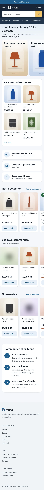
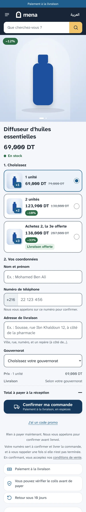
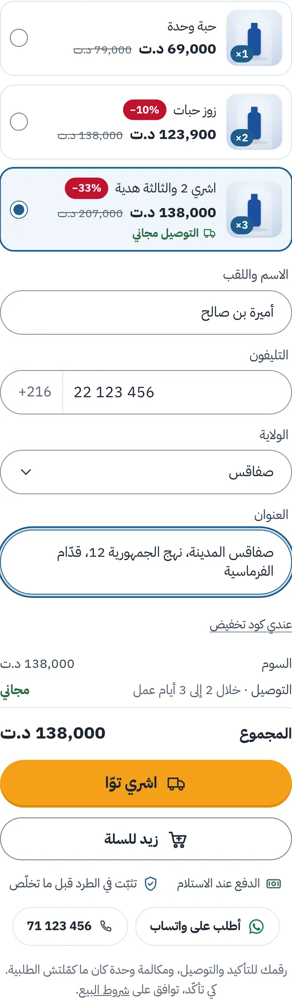
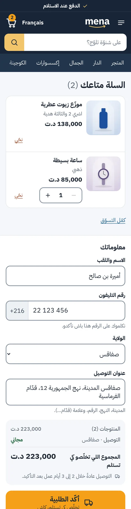
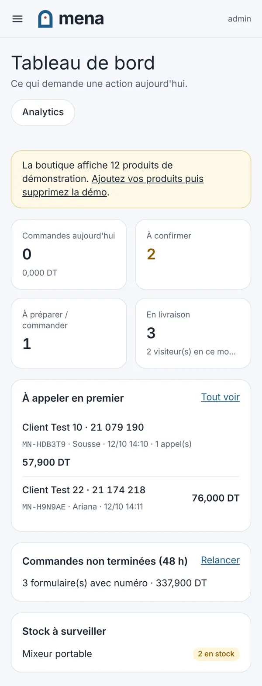

# Mena

Boutique en ligne pour la Tunisie : dropshipping, paiement à la livraison, en arabe tunisien d'abord (le français est sous `/fr`).

- **Recherche marché** : [docs/RESEARCH.md](docs/RESEARCH.md)
- **Mise en ligne et routine** : [docs/DEPLOIEMENT.md](docs/DEPLOIEMENT.md)

| Accueil | Fiche produit | Commande | Panier | Back-office |
|---|---|---|---|---|
|  |  |  |  |  |

## Boutique

- Pensée pour des clients qui ne sont pas à l'aise avec les sites : gros caractères (Atkinson Hyperlegible), couleurs douces, contrastes vérifiés, cases bien visibles.
- **Un site calme et clair, peu de mots** : fond blanc, bordures fines, champs et boutons arrondis, un seul orange pour acheter. En-tête blanc avec une grande recherche arrondie et les catégories en pastilles ; une barre discrète dit le paiement à la livraison et le tarif de livraison. Accueil : une phrase, les catégories en photos, les rayons, puis « كيفاش تطلب » en trois lignes.
- **Fiche produit claire**, sur téléphone d'abord, peu de mots et des tailles régulières : les photos dans un cadre léger avec leurs vignettes centrées, la vidéo en 2e position (YouTube, Vimeo, TikTok, Instagram, Facebook ou un fichier envoyé depuis l'ordinateur, chargée seulement si on appuie), le plein écran avec zoom (le bouton Retour du téléphone le ferme) ; puis le nom, une description courte, le prix sur une ligne (prix, ancien prix réel, pourcentage) qui ne bouge pas quand on choisit une offre ; les offres en cartes légères ; les options dans une liste déroulante avec la pastille de leur couleur ; le formulaire en quatre champs arrondis, chacun avec son nom au-dessus (sur téléphone, le nom et l'adresse sur toute la largeur, le téléphone et la wilaya côte à côte ; deux par ligne sur ordinateur) ; le récapitulatif en trois lignes et le bouton orange. Sous le formulaire, des rubriques soulignées comme des onglets : grandes images puis description, caractéristiques, avis. En bas de l'écran, le prix du choix en cours et le bouton.
- Le formulaire reste sur la fiche : offre (« 1 unité », « 2 + 1 offerte »…), nom, téléphone (+216, 8 chiffres), gouvernorat, adresse. **« Acheter maintenant »** (le bouton orange, le plus visible) commande tout de suite ; **« Ajouter au panier »** dessous, en plus discret. Une barre en bas de l'écran garde le prix et « Acheter maintenant » à portée de pouce.
- **Panier** (`/panier`) pour commander plusieurs produits en une fois : même formulaire, mêmes contrôles serveur ; une ligne refusée (rupture, offre terminée) est retirée avec une phrase qui le dit. Compteur dans l'en-tête, fenêtre « Ajouté au panier » avec « Commander mon panier » ou « Continuer mes achats ».
- **Cartes produit** sans cadre, avec des faits seulement : photo encadrée, nom, prix juste dessous (alignés d'une carte à l'autre), pourcentage réel, un seul fait en couleur (meilleure offre lot, livraison offerte ou stock bas réel), étoiles et commandes réelles sur une ligne discrète. Bouton « Acheter » qui ouvre la commande rapide.
- Rapide sur téléphone : contenu principal affiché en 0,8 à 1,3 s en 4G lente avec un processeur ralenti ×4, sans décalage de mise en page.
- **« Acheter maintenant » sur chaque carte produit** (accueil, catégories, recherche) : le formulaire de commande s'ouvre par-dessus la liste, sans changer de page. Mêmes prix et mêmes contrôles serveur que la fiche.
- **Un seul tarif de livraison pour tous les gouvernorats** (8 DT par défaut, à changer en un endroit dans Paramètres) : le total exact s'affiche dès le début, avant même le choix du gouvernorat. Les délais restent par gouvernorat.
- Sous le prix, une ligne : le tarif de livraison et le délai réglés dans Paramètres. Juste avant le bouton : paiement à la livraison, colis vérifiable avant de payer (si activé). Sous le formulaire, « قبل ما تطلب » : quatre questions fermées (délai, paiement, appel de confirmation, retour), chaque réponse construite à partir des paramètres.
- **Barre du bas sur téléphone** dès le premier écran (même dans le navigateur de Facebook), cachée seulement quand le formulaire est à l'écran. Elle mène à ce qui manque : l'option, puis le premier champ vide, sinon le bouton.
- **Jamais deux commandes pour une** : chaque envoi porte une clé unique ; s'il est renvoyé (réponse perdue sur un réseau faible, deuxième appui), le serveur rend la commande déjà faite. Le bouton reste bloqué pendant le chargement de la page « Merci ». Le produit commandé depuis sa fiche quitte le panier. Sans réponse après 25 s, une phrase le dit et le même appui peut être refait sans risque.
- Si le calcul du prix échoue (réseau, adresse partagée chez l'opérateur), il est refait automatiquement ; la commande peut quand même partir, le serveur recalculant le total.
- Le bouton Retour du téléphone ferme la commande rapide et la fenêtre « Ajouté au panier » au lieu de quitter le site. Le bandeau cookies se place au-dessus de la barre de commande.
- Numéro de téléphone accepté aussi en chiffres arabes (٢٢١٢٣٤٥٦) ou avec un 0 devant.
- Bulle WhatsApp sur l'accueil et les listes (une petite phrase « Une question ? » la présente une fois par visite), bouton WhatsApp sur chaque fiche, et confirmation WhatsApp proposée après la commande.
- **Recherche comme Google** : une recherche de plusieurs mots dont un seul existe dans la boutique (« sac femme ») montre les produits de ce mot et le dit ; une recherche sans résultat propose les catégories et des produits ; complétion pendant la frappe, produits avec photo et prix dès deux lettres, fautes de frappe pardonnées (« lamep de chevt » → « lampe de chevet »), en français, en arabe et en tunisien écrit en lettres latines grâce aux mots-clés de chaque produit ; la page de résultats dit quel mot a été corrigé.
- **Référencement Google** : titre de page fait des mots du produit puis de sa catégorie (comme Amazon), description qui reprend le nom, le prix réel et le paiement à la livraison, adresses lisibles, ancienne adresse redirigée quand un produit change de nom, hreflang arabe/français + x-default, données structurées (produit avec livraison et retours, liste de catégorie, recherche du site, fil d'Ariane), plan du site avec les photos.
- Suivi de commande par lien secret (SMS) ou par numéro de commande + téléphone. Demande de retour et avis depuis la page de suivi.
- Un formulaire laissé avec un numéro apparaît dans « Non terminées » pour une relance, avec un lien qui rouvre la fiche sur le même choix (ou le panier, s'il y avait plusieurs produits).
- SEO : métadonnées, sitemap FR/AR, données structurées produit. Pixels Meta, TikTok et GA4 (avec API serveur) chargés seulement après consentement.

**Règle de la maison : n'afficher que des données réelles.** Pas de faux stock, de faux compte à rebours, de faux avis, de faux « X personnes regardent ». Un avis ne peut venir que d'une commande livrée, et n'est publié qu'après modération. Le prix barré d'un lot vient de l'offre « 1 unité » réelle ; « Le plus choisi » vient des commandes ; « +20 commandes » compte les commandes confirmées des 30 derniers jours, arrondi vers le bas, et ne s'affiche pas sous 10 ; une date de fin d'offre est celle saisie dans le back-office.

**Le navigateur n'est jamais cru.** Le serveur recalcule prix, variantes, stock, remise, quantités et frais de livraison à chaque devis et à chaque commande. Une commande dont le total diffère de celui affiché est arrêtée, et le client voit le nouveau total.

## Back-office (`/admin`)

Commandes (file de confirmation, appels notés, statuts, refus avec motif, liste noire), produits (**import CSV** de centaines de produits avec photos, catégories, options et offres, sans doublon si le fichier est réimporté ; export dans le même format ; traduction en lot, avec ou sans clé ; modification rapide et actions groupées dans la liste ; précédent/suivant, Ctrl+S et copie d'un produit dans l'éditeur ; traduction automatique en arabe tunisien, description courte, photos, vidéo, caractéristiques, images de description, mots-clés de recherche, titre et description pour Google avec aperçu, variantes en deux langues avec leur couleur, offres (« 1 » et « 2 + 1 offerte » proposées d'un clic, leurs prix suivant celui du produit), coût fournisseur, stock), catégories, fournisseurs, clients, codes promo, commandes non terminées, retours, avis, paramètres. Exports CSV.

**Rentabilité** (*Analytics*) : CA livré − coût des produits − transport par colis − colis revenus − publicité = bénéfice ; coût publicitaire par commande livrée, par source. Les dépenses se saisissent dans *Dépenses pub* ; ce qu'il manque pour un chiffre exact est nommé, jamais deviné. *Commandes → Nouvelle commande* pour les commandes prises sur WhatsApp ou au téléphone. L'achat peut être signalé aux publicités à la livraison.

**Analytics** : mesure d'audience interne, sans service extérieur. Temps réel, visiteurs, entonnoir (visite → fiche → formulaire commencé → téléphone saisi → commande → confirmée → livrée), conversion par source, campagne et appareil, CA, panier moyen, marge, produits vus mais pas achetés, recherches sans résultat, commandes non terminées, ajouts au panier et commandes par origine (fiche, commande rapide, panier), photos en plein écran et vidéos lancées, clics WhatsApp et appels, refus par gouvernorat, clients fidèles, cohortes, commandes par heure.

**Publicités** : ce que chaque campagne et chaque publicité coûte et rapporte, jusqu'à la commande livrée. La dépense vient de l'export Meta ou TikTok collé dans *Importer* (un même export importé deux fois, ou à un autre niveau de détail, ne compte qu'une fois) ou de *Dépenses pub* ; les visites et commandes, des liens avec utm_campaign et utm_content (*Idées* les fabrique avec les codes de Meta et TikTok). Le juge est le coût par commande livrée face au coût max que la marge permet (*Seuils*, produit par produit et offre par offre) : verdict par ligne (monter, garder, corriger, couper, attendre, mesure cassée), avec sa probabilité, le point faible de l'entonnoir, la fatigue des créatives, la tendance des 7 derniers jours, les commandes en attente d'appel depuis plus de 48 h et l'effet du délai du premier appel. Sans dépense ou sans coûts, la case reste vide et dit ce qui manque. *Audience* : confirmation et refus par gouvernorat, appareil, heure et jour ; *Clients* : nouveaux clients et ce qu'ils rapportent à 30, 60 et 90 jours ; *Idées* : brief créatif tiré des vraies données du produit, et une demande prête pour claude.ai.

## Technique

Next.js 16 (App Router), Prisma 6 et Postgres, déployable sur Vercel. Montants en millimes (entiers). Tests unitaires : `npm test`. Tests navigateur : `npm run e2e`, sur base locale uniquement.
