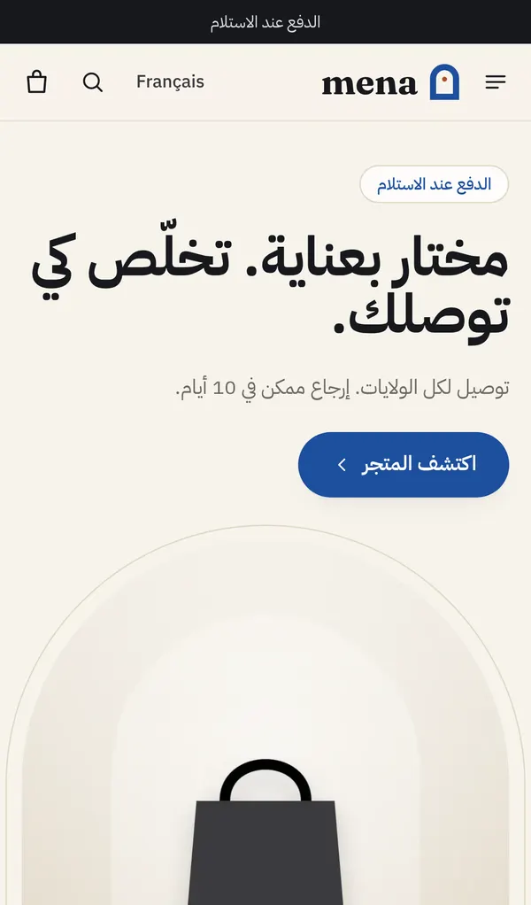

# Mena

Boutique en ligne pour la Tunisie : dropshipping, paiement à la livraison, français et arabe.

- **Recherche marché** : [docs/RESEARCH.md](docs/RESEARCH.md)
- **Mise en ligne et routine** : [docs/DEPLOIEMENT.md](docs/DEPLOIEMENT.md)

| Accueil | Fiche produit | Commande | Arabe | Back-office |
|---|---|---|---|---|
|  |  |  |  |  |

## Boutique

- Pensée pour des clients qui ne sont pas à l'aise avec les sites : gros caractères (Atkinson Hyperlegible), couleurs douces, contrastes vérifiés, cases bien visibles.
- Accueil organisé comme Amazon : en-tête sombre avec une grande recherche, hautes cartes de catégories avec flèches, boîtes « 4 produits », rayons.
- Fiche produit organisée comme les boutiques tunisiennes que les clients connaissent : photos (vignettes sur le côté sur ordinateur), prix, offres en cartes (image ×N, prix barré réel, % sur les lots), formulaire nom | téléphone et adresse | gouvernorat, gros bouton sombre. Sur téléphone, le nom et le prix tiennent sur le premier écran.
- Rapide sur téléphone : contenu principal affiché en 0,8 à 1,3 s en 4G lente avec un processeur ralenti ×4, sans décalage de mise en page.
- **Pas de panier** : on commande sur la fiche produit, dans un seul formulaire. On choisit l'offre (« 1 unité », « 2 + 1 offerte »…), puis nom, téléphone (+216, 8 chiffres), gouvernorat, adresse, et on confirme. Paiement à la livraison, sans compte ni e-mail.
- Frais et délai de livraison par gouvernorat, total affiché avant de confirmer, tirés des réglages.
- Bouton WhatsApp sur chaque fiche, et confirmation WhatsApp proposée après la commande.
- Suivi de commande par lien secret (SMS) ou par numéro de commande + téléphone. Demande de retour et avis depuis la page de suivi.
- Un formulaire laissé avec un numéro apparaît dans « Non terminées » pour une relance, avec un lien qui rouvre la fiche sur le même choix.
- SEO : métadonnées, sitemap FR/AR, données structurées produit. Pixels Meta, TikTok et GA4 (avec API serveur) chargés seulement après consentement.

**Règle de la maison : n'afficher que des données réelles.** Pas de faux stock, de faux compte à rebours, de faux avis, de faux « X personnes regardent ». Un avis ne peut venir que d'une commande livrée, et n'est publié qu'après modération. Le prix barré d'un lot vient de l'offre « 1 unité » réelle ; « Le plus choisi » vient des commandes ; une date de fin d'offre est celle saisie dans le back-office.

**Le navigateur n'est jamais cru.** Le serveur recalcule prix, variantes, stock, remise, quantités et frais de livraison à chaque devis et à chaque commande. Une commande dont le total diffère de celui affiché est arrêtée, et le client voit le nouveau total.

## Back-office (`/admin`)

Commandes (file de confirmation, appels notés, statuts, refus avec motif, liste noire), produits (photos, variantes, offres, coût fournisseur, stock), catégories, fournisseurs, clients, codes promo, commandes non terminées, retours, avis, paramètres. Exports CSV.

**Analytics** : mesure d'audience interne, sans service extérieur. Temps réel, visiteurs, entonnoir (visite → fiche → formulaire commencé → téléphone saisi → commande → confirmée → livrée), conversion par source, campagne et appareil, CA, panier moyen, marge, produits vus mais pas achetés, recherches sans résultat, commandes non terminées, clics WhatsApp et appels, refus par gouvernorat, clients fidèles, cohortes, commandes par heure.

## Technique

Next.js 16 (App Router), Prisma 6 et Postgres, déployable sur Vercel. Montants en millimes (entiers). Tests unitaires : `npm test`. Tests navigateur : `npm run e2e`, sur base locale uniquement.
